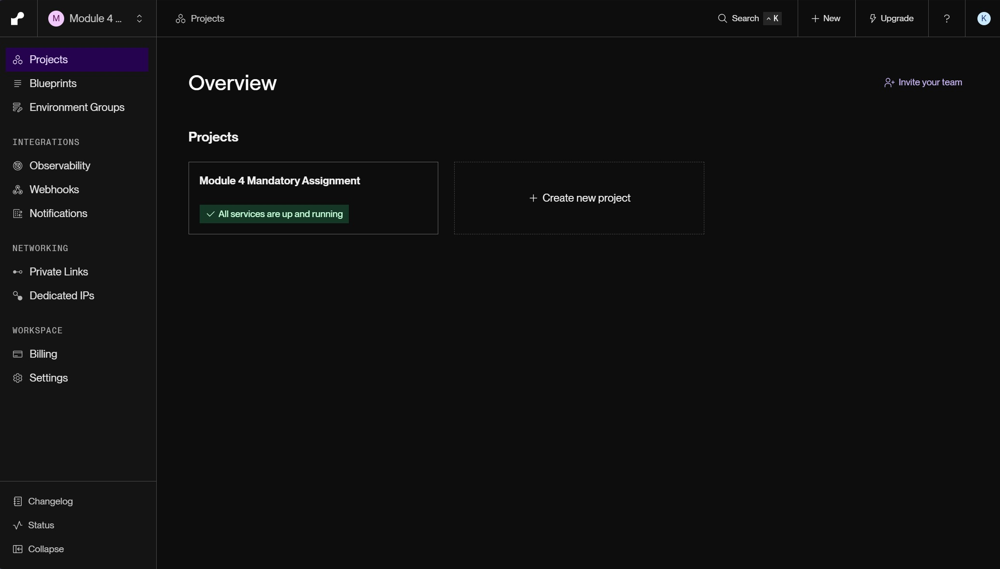
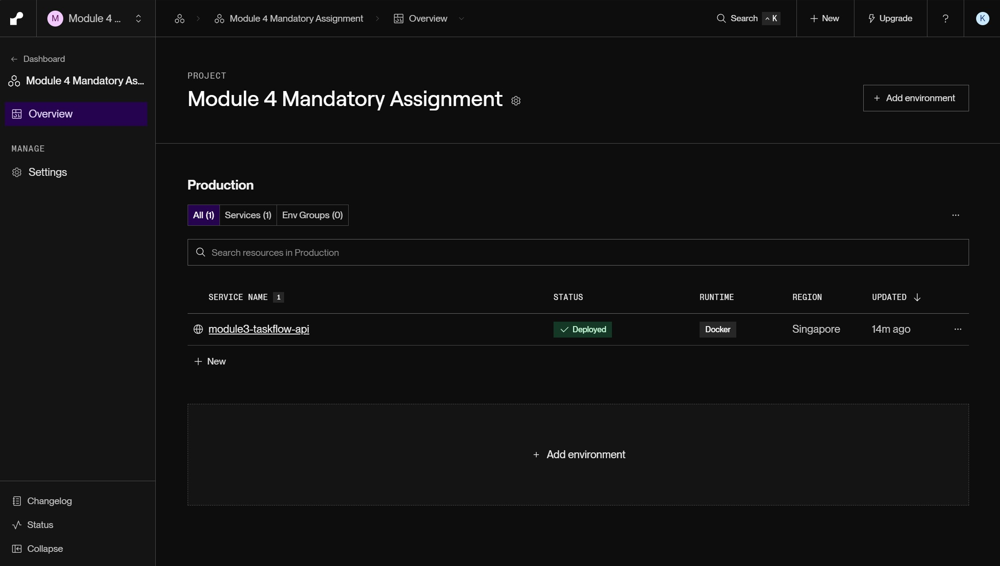
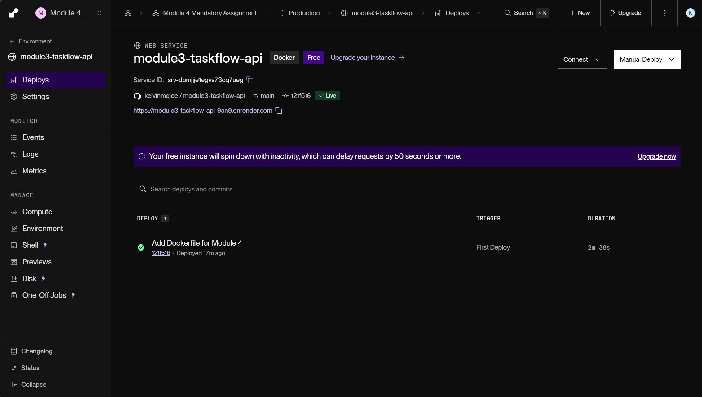
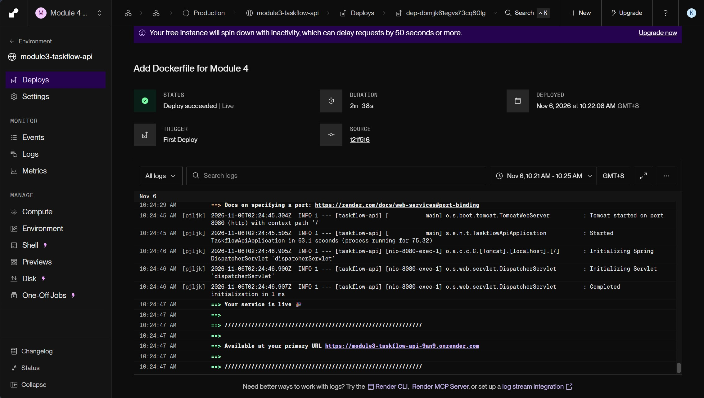
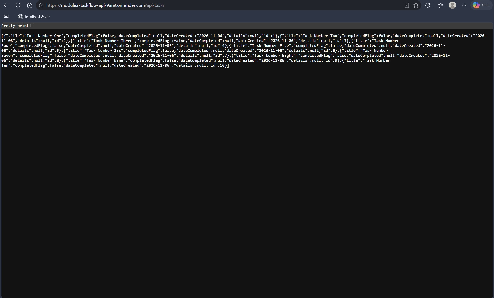

Module 4 Mandatory Assignment - TaskFlow API

--- Live Application URL on Render ---

https://module3-taskflow-api-9an9.onrender.com/api/tasks

--- Screenshots ---

Screenshot: Render Dashboard

Screenshot: Live Application

--- Errors and Failures ---

None for now.

--- Stretch Goal (optional) ---

Stretch goal: Option 1 - Add a CI Pipeline
Links: 
Notes: 

GitHub Actions builds and tests on pushes to `main`. Docker Hub publishing
requires repository secrets configured under Settings > Secrets and variables > Actions:

- `DOCKER_USERNAME`: your Docker Hub username.
- `DOCKER_TOKEN`: a Docker Hub access token with permission to push images.

If either secret is missing, publishing is skipped with a warning. When both are
configured, the workflow publishes `<DOCKER_USERNAME>/taskflow:latest` after tests pass.
