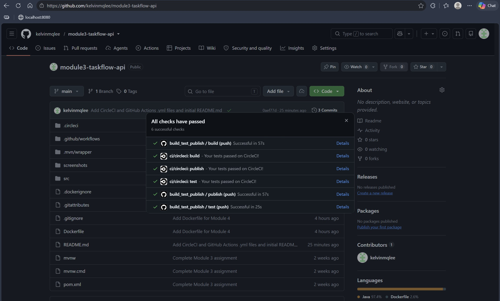
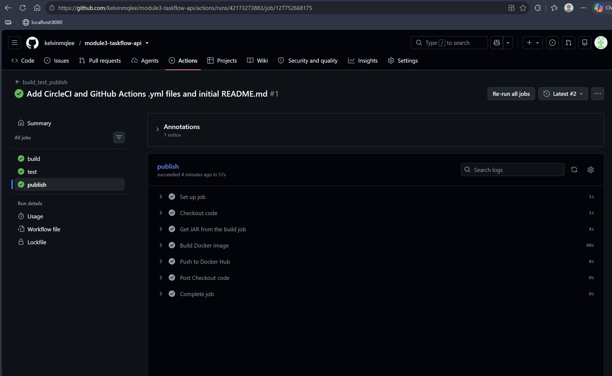
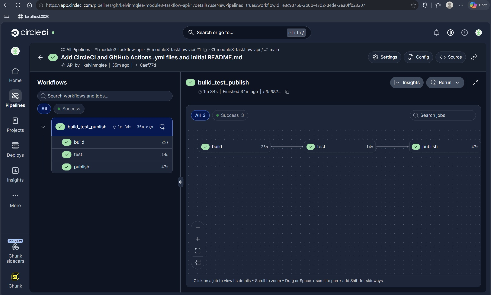
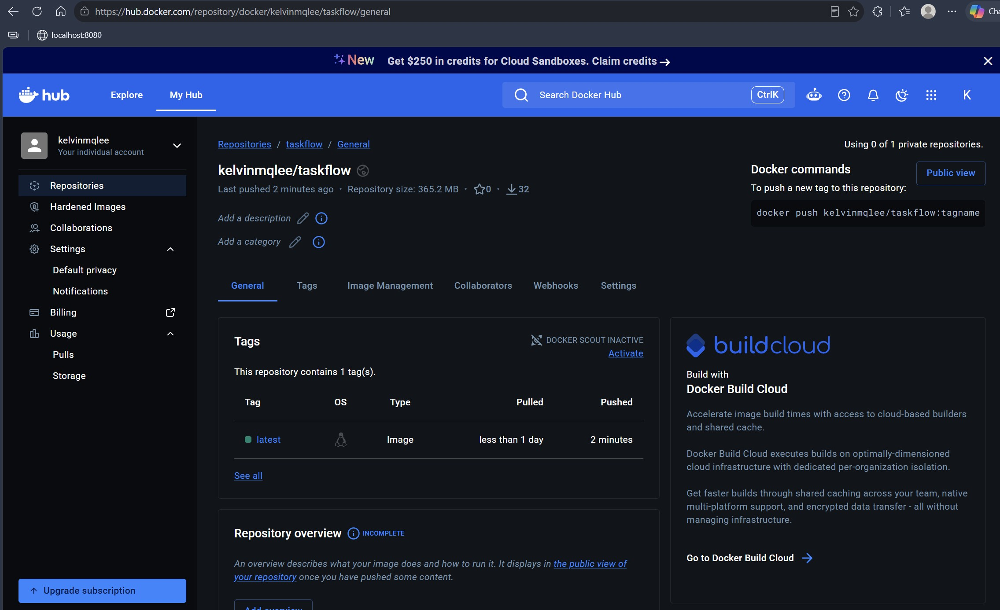
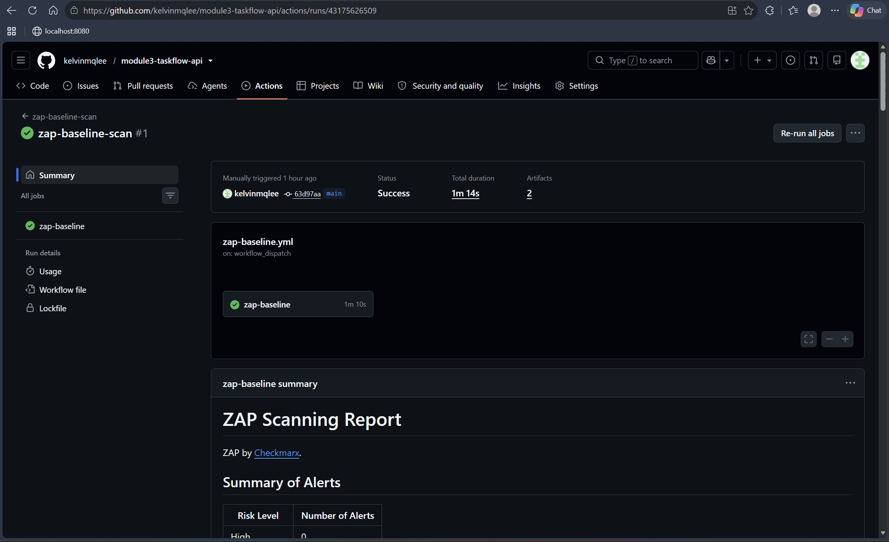
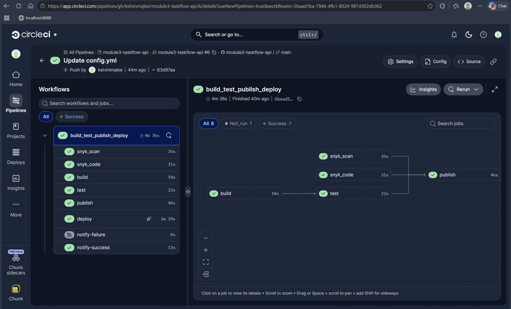
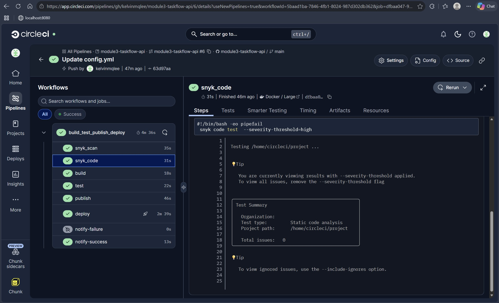
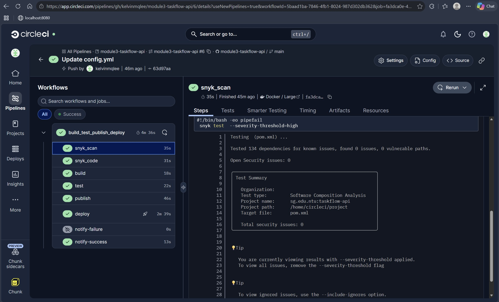
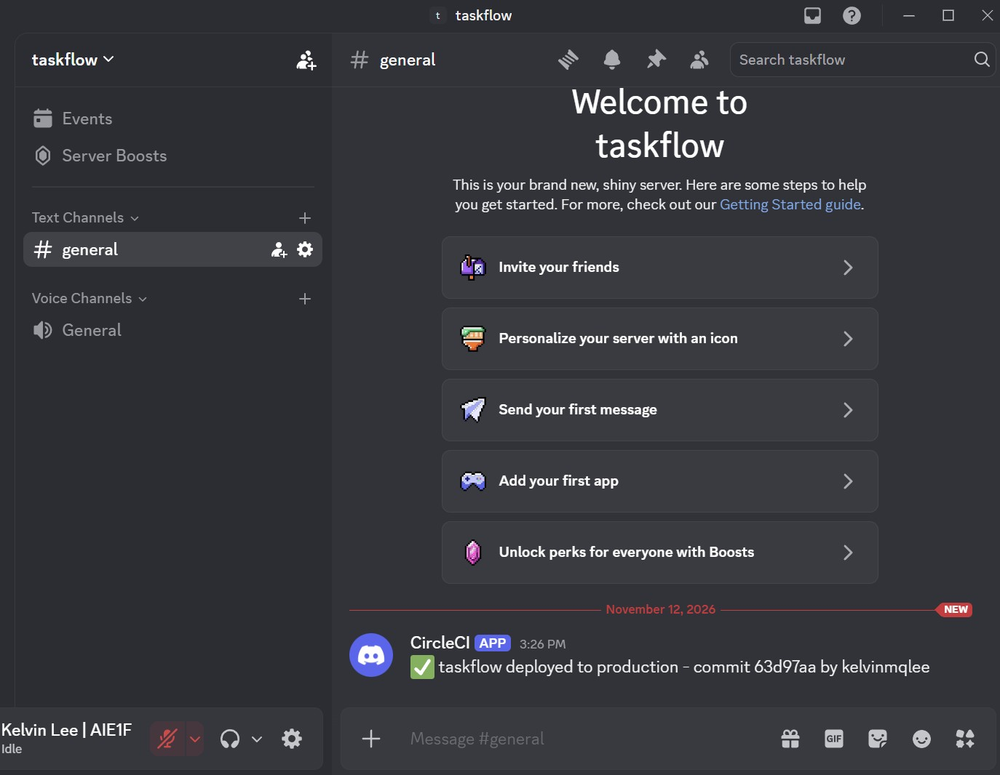
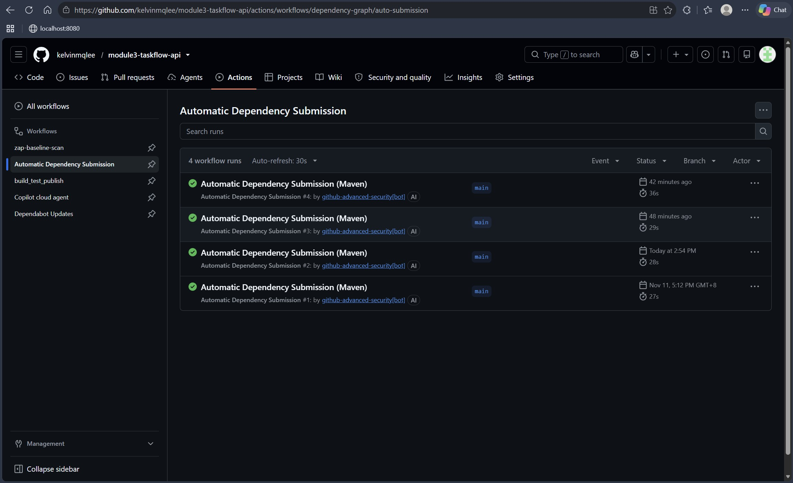

# Module 4 Mandatory Assignment - TaskFlow API

## --- Live Application URL on Render ---

https://module3-taskflow-api-9an9.onrender.com/api/tasks

## --- Screenshots ---

### Screenshot: Render Dashboard

### Screenshot: Live Application

## --- Errors and Failures ---

1. I encountered a failed Pipeline run when publishing on GitHub Actions for the first run. I rectified it by updating the appropriate Repository Secrets to this repository.

2. I do not fully understand the coding in .circleci/config.yml, therefore I encountered quite a few "deploy" errors before knowing what to edit in the coding to make the whole project work successfully, after learning how to implement the coding for this assignment.

## --- Stretch Goals (Optional) ---

### OPTION 1: ADD A CI PIPELINE

#### Links: 
#### 1. Successful Pipeline Run with GitHub Actions - https://github.com/kelvinmqlee/module3-taskflow-api/actions/runs/42173273883/job/127752668175

#### 2. Successful Pipeline Run with CircleCI - https://app.circleci.com/pipelines/gh/kelvinmqlee/module3-taskflow-api/1/details?useNewPipelines=true&workflowId=e3c98766-2b0b-43d2-84de-2e30ffb23207

#### 3. Latest Image on Docker Hub - https://hub.docker.com/repository/docker/kelvinmqlee/taskflow/general

#### Notes: 
After clarification with trainer Jesstern, I learned that there is no conflict if I add both GitHub Actions and CircleCI Pipeline Run in the same project, therefore I decided to implement both in this assignment.

### OPTION 5: ADD SECURITY CHECKS

#### Links:
#### 1. Successful OWASP ZAP Scan with CircleCI Pipeline Run - https://github.com/kelvinmqlee/module3-taskflow-api/actions/runs/43175626509

#### 2. ZAP Scanning Report - https://github.com/kelvinmqlee/module3-taskflow-api/actions/runs/43175626509/artifacts/13924546377

#### 3. Successful CircleCI Pipeline Run with Snyk Code job and Snyk Scan job - https://app.circleci.com/pipelines/gh/kelvinmqlee/module3-taskflow-api/6/details?useNewPipelines=true&workflowId=5baad1ba-7846-4fb1-8024-987d302db362

#### 4. GitHub Actions Dependabot in action - https://github.com/kelvinmqlee/module3-taskflow-api/actions/workflows/dependency-graph/auto-submission

#### Notes:
I have discovered 1 CRITICAL security issue and 3 LOW security issues in total, after running Snyk Code Test and Snyk Test CLI commands, and I have implemented the necessary changes to pom.xml so as to validate and override the security issues. As I have also verified with Co-Pilot regarding the security issues, only 1 LOW security issue was safe to be ignored, while the rest are to be fixed. I ran the appropriate CLI command to ignore that issue, thus creating the .snyk file in the root folder.